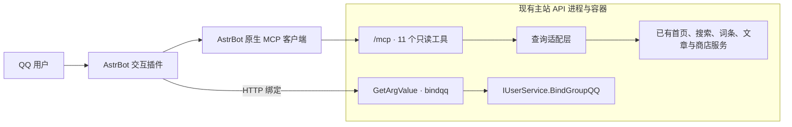

# CnGal 交互插件部署

当前版本为 **v1.0.0**，声明支持 AstrBot **>=4.29.3**，仅处理 **QQ／OneBot v11（aiocqhttp）**。插件使用宿主提供的 aiohttp，不需要额外的 requirements.txt。查询由现有主站 API 内的 `/mcp` 提供，账号绑定复用已有机器人接口。

## 安装与更新

在 AstrBot 原生插件管理中通过仓库链接安装：

```text
https://github.com/CnGal/CnGalWebSite/tree/astrbot-plugin
```

维护者首次成功运行发布工作流后，该地址才可使用。后续在插件管理中点击更新，从同一分支获取插件；主仓库开发提交不会直接更新该分支。不要使用主仓库根地址或主分支插件子目录的网页地址安装。

离线部署可按本文的打包命令生成 `astrbot_plugin_cngal_interaction-1.0.0.zip`，在原生插件管理中上传安装或更新。更新前备份 AstrBot 运行数据；保留插件数据目录、原生配置和人设，不需要将人设或素材文件复制回插件目录。

## 连接 API 内置 MCP

部署包含本次修改的 `CnGalWebSite.APIServer`，`/mcp` 与现有 API 共用进程、容器和监听端口。该入口只公开 11 个只读查询工具，沿用站内公开资料的可见范围；无需单独 MCP 容器、RabbitMQ 接入或新增令牌。

在 API 配置中设置公开站点地址，AstrBot 的 MCP 查询结果通过此配置生成站内链接：

```json
{
  "Site": { "PublicBaseUrl": "https://www.cngal.org/" }
}
```

容器环境变量对应 `Site__PublicBaseUrl`。这里填写用户访问的站点地址，API 地址则用于连接和绑定。有效的外部新闻来源链接会保留。

在 AstrBot 原生 MCP 管理中按 [mcp_server.example.json](mcp_server.example.json) 添加服务，传输方式为 `streamable_http`，URL 指向 API 的 `/mcp`。示例为 `https://api.cngal.org/mcp`；内部容器地址可使用实际 API 服务名与端口。确保 AstrBot 进程能访问该地址，反向代理将 `/mcp` 转发至现有 API，并允许流式响应。连接成功后应发现 11 个 CnGal 查询工具。



## 模型、会话与人设

1. 在 AstrBot 中配置模型提供商和支持工具调用的聊天模型，在获准聊天配置的本地 Agent 中选择该模型。模型凭据由原生配置管理。
2. 默认配置：在已有配置上应用[基础补丁](astrbot-profile.patch.json)，关闭默认 AI。新聊天配置：每次从原生默认值新建非默认配置档后，都先应用基础补丁，再应用[聊天补丁](astrbot-chat-profile.patch.json)，开启该配置的 AI。不能只应用聊天补丁，否则会遗漏人设和中间消息缓冲等设置。字典递归合并，列表及普通值替换，不能用补丁覆盖完整配置；保留原有模型和平台连接参数。
3. 在默认配置及受管理的 QQ 配置中，保留原有插件选择，并在原生插件选择界面明确加入 `astrbot_plugin_cngal_interaction`；仅选择通配项 `*` 不满足本插件的准入条件。两份补丁均不修改插件选择，也不关闭原有的 ID 白名单；保留各配置已有的白名单设置。按 [路由示例](astrbot-routes.example.json)，在原生配置档绑定界面将允许聊天的群或私聊精确绑定到聊天配置档。
4. 将 `REPLACE_PLATFORM_ID` 替换为 AstrBot 中的机器人平台实例 ID，将 `REPLACE_CHAT_PROFILE_ID` 替换为聊天配置档 ID，并替换示例群号或 QQ 号。群格式为 `平台ID:GroupMessage:群号`，私聊格式为 `平台ID:FriendMessage:QQ号`。通配路由不能开放聊天，较早匹配的通配路由也不能遮住精确路由。
5. 在原生人设管理中新建或选择 ID 为 `cngal` 的人设，导入管理员准备的完整内容，再按 [人设选择示例](cngal-persona-selection.example.json) 选择 11 个 MCP 查询工具和 `cngal_asset`，Skills 设为空列表。如使用其他人设 ID，须同步修改配置补丁中的引用。

群聊通过“看板娘”或 @机器人唤醒；获准私聊可直接交流。会话总开关、会话插件开关和 AI 开关仍由 AstrBot 原生管理。仅开启模型或添加通配路由不等于授权聊天。

仓库不提供人设正文，由管理员自行编写、维护并通过 AstrBot 原生人设管理导入；插件不会自动覆盖已有的人设。生日是公开固定信息，代码按上海日期计算并注入当前年龄。

## 账号绑定

在插件设置中填写主站 API 的 `api_base_url`。插件调用已有 `POST api/robot/GetArgValue`，发送 `name=bindqq`、`infor=绑定 <绑定码>` 和真实消息发送者的 `senderId`。此入口沿用现有匿名调用方式，绑定码有效期为 1 小时且使用后失效，不需要另外配置鉴权令牌。

公网连接建议使用 HTTPS。现有配置仍支持 HTTP，但它会明文传输绑定码和 QQ 号；这是保留的传输风险，未通过本次修改消除。

绑定请求超时为 15 秒，不自动重试。用户收到失败或超时回执后，可检查主站绑定状态并重新获取绑定码。群内发送绑定码会让同群成员看到它，私聊可减少暴露；匿名入口无法独立验证调用方填写的 QQ 身份，这一边界与旧机器人相同。

发送“看板娘绑定 绑定码”执行确定性绑定，直接使用实际发送者身份调用主站，不经过 AI。私聊绑定不要求创建 AI 聊天路由，但需选中插件且会话、插件开关开启；群绑定沿用获准会话范围。单独发送“绑定”等缺参咨询按 AI 聊天权限处理。

## 素材

真实素材清单保存在 AstrBot 的插件数据目录：

```text
data/plugin_data/astrbot_plugin_cngal_interaction/assets.json
```

实际位置以 `StarTools.get_data_dir("astrbot_plugin_cngal_interaction")` 返回值为准。该目录属于运行数据，应纳入部署持久卷；不要把真实清单放回插件源码目录。插件源码不包含素材清单。

清单格式如下，示例地址需要换成可访问的真实素材地址：

```json
{
  "示例表情": {
    "kind": "image",
    "usage": "expression",
    "url": "https://example.invalid/expression.png"
  },
  "示例语音": {
    "kind": "record",
    "usage": "voice",
    "url": "https://example.invalid/voice.amr"
  }
}
```

`expression` 和 `illustration` 对应 `image`；`voice` 对应 `record`。素材名称不能为空，地址必须是非空字符串。

插件加载时读取清单，更新后重载插件生效。文件缺失或内容为 `{}` 时没有可用素材；读取或格式错误会记录日志并停用素材功能，文字聊天与绑定仍可使用。每次回复最多选择一个素材，发送时只包含一张图片或一条语音。

升级插件时保留原生插件数据目录，完整人设仍由原生人设管理保存。

## 限流配置

在插件设置中调整 `rate_limit`，保存后重载插件生效：

| 配置项 | 默认值 | 含义 |
|---|---:|---|
| window_seconds | 60 | 统计窗口秒数 |
| user_limit | 5 | 同一用户在所有会话中的额度 |
| session_limit | 10 | 单个会话的额度 |
| global_limit | 60 | 本插件实例的全局额度 |

所有值必须是正整数；缺省使用默认值，无效值会报告对应配置项。参数由全部会话共用，同时作用于聊天和确定性绑定。通过检查后统一计数，拒绝的请求不占额度，同一事件不重复计数。同一受限窗口只提示一次。

## 本地开发与打包

从主仓库根目录执行，Python 脚本和依赖统一使用 uv。开发基线为 Python 3.15.1，执行时记录实际解释器版本；AstrBot 部署环境以所选宿主版本的运行要求为准。

```powershell
uv run --no-project --no-python-downloads python --version
uv run --no-project --no-python-downloads python integrations/astrbot/tools/package.py
uv run --no-project --no-python-downloads python integrations/astrbot/tools/check_package.py --repository CnGal/CnGalWebSite
```

默认输出目录为已忽略的 `integrations/astrbot/dist`，生成 `astrbot_plugin_cngal_interaction-1.0.0.zip` 和 `sha256.json`。ZIP 包含公开插件源码、README 和 LICENSE；部署配置示例位于主仓库，人设正文由部署方自行准备。发布清单以本次 `sha256.json` 为准，旧版本 ZIP 和其他产物会保留。`check_package.py` 校验版本、平台、许可证、源码和 ZIP 的逐文件一致性；无需本地测试文件或暂存代码。

## 发布分支

维护者将经过验证的公开修改提交到默认分支后，在 `CnGal/CnGalWebSite` 的 GitHub Actions 中手动运行 `Publish AstrBot plugin`。工作流只允许默认分支执行，固定检出触发时的提交，使用 uv／Python 3.15.1 打包并检查版本、平台声明、许可证及 ZIP 与提交内容的一致性。

工作流使用仓库自带的 `GITHUB_TOKEN` 和 `contents: write` 权限，以插件子目录作为 `astrbot-plugin` 分支的根目录。首次发布创建独立历史，后续仅以上次发布为父提交，提交说明记录版本和主仓库来源提交。公开内容相同则跳过；更新采用普通推送，不强制覆盖发布历史。

该分支由工作流维护，修改应提交到主仓库中的插件源码目录。发布前检查公开源码和 ZIP，确保没有完整人设、真实素材清单或凭据。工作流不会将主仓库历史、部署配置、测试或本地交接文件导出到发布分支。

当前已验证的受支持宿主版本为 AstrBot 4.29.3；兼容范围声明不等于该范围内所有版本均完成回归。Python 3.15.1 本地检查与AstrBot 4.29.3／Python 3.12 隔离检查分别记录，不能据本地检查推断完整 AstrBot 已在 Python 3.15 验证。
